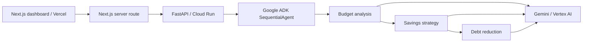

# Steady · Financial Coach

A Next.js personal-finance workspace backed by a Python Google ADK multi-agent system. Adapted from [Shubhamsaboo's AI Financial Coach](https://github.com/Shubhamsaboo/awesome-llm-apps/tree/main/advanced_ai_agents/multi_agent_apps/ai_financial_coach_agent).

**Status:** runnable local prototype. Demo mode performs arithmetic without model calls. Live mode uses Gemini through Vertex AI. Cloud deployment and live model access must be verified separately.

## Architecture



The original three agent roles, prompts, and Pydantic output schemas are retained in `backend/agents.py`. This adaptation replaces Streamlit with React, introduces a validated HTTP boundary, upgrades ADK with locked dependencies, awaits session APIs, uses unique request sessions, explicitly injects prior agent outputs, and validates final structured results. It removes silent fabricated fallback forecasts. See [architecture decisions](docs/architecture.md).

## Local setup

Requirements: Node.js 22+, Python 3.12+, uv.

```powershell
npm ci
Copy-Item .env.example .env.local
cd backend
uv sync --locked
Copy-Item .env.example .env
uv run --locked uvicorn main:app --host 127.0.0.1 --port 8080
```

In a second terminal at the repository root:

```powershell
npm run dev
```

Open http://127.0.0.1:3001. Enter income, expenses, and optional debts, then select **Build my coaching plan**. Results explicitly identify demo mode.

## Live Vertex AI test

Use your billing-enabled project `oreos-509708`. Credit eligibility depends on your billing account and credit terms; Vercel charges are separate from Google Cloud.

```powershell
gcloud auth application-default login
gcloud services enable aiplatform.googleapis.com --project oreos-509708
gcloud auth application-default set-quota-project oreos-509708
```

In `backend/.env`, set `COACH_MODE=live`, `GOOGLE_CLOUD_PROJECT=oreos-509708`, `GOOGLE_GENAI_USE_VERTEXAI=TRUE`, `GOOGLE_CLOUD_LOCATION=global`, and a Gemini model available to your project using `GEMINI_MODEL`. Restart the backend and test with synthetic numbers. No Google API key is needed with Application Default Credentials. Never commit credentials.

## Checks

```powershell
npm run typecheck
npm run build
cd backend
uv run --locked python -m unittest discover -s tests -v
```

CI runs these same checks. Unit tests do not call paid models.

## Deployment

See [deployment guide](docs/deployment.md) for Vercel and Cloud Run setup. The included container is for the Python service. The frontend repository root is the Vercel project root.

## Scope and portfolio evidence

Implemented: responsive input dashboard, debt entry, three result panels, structured ADK orchestration, session isolation, server-side cloud configuration, request validation, explicit failures, execution timing, locked dependencies, CI, and deployment documentation.

Still to build: CSV import in the new UI, persistent authenticated user accounts, durable runs, streaming progress, model-quality evaluation fixtures, deterministic debt amortization, and production rate limits. This is not a production financial advisory system. AI-generated payoff figures require independent verification.

Live mode sends financial inputs to Google. The application does not persist profiles; provider/platform logging and retention policies still apply. Use synthetic data for initial testing.

## Attribution

The original source is preserved in `upstream/ai_financial_coach_agent.py` for review and attribution; it is not imported by the application. Original Apache-2.0 license is retained in LICENSE. The Next.js interface, API adaptation, tests, and deployment structure are additions in this repository.
