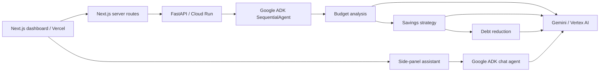

# Steady · Financial Coach

A Kenya-localized Next.js personal-finance workspace backed by a Python Google ADK multi-agent system. Amounts are in Kenyan shillings (KES), and the example figures are synthetic test data rather than local spending benchmarks. Adapted from [Shubhamsaboo's AI Financial Coach](https://github.com/Shubhamsaboo/awesome-llm-apps/tree/main/advanced_ai_agents/multi_agent_apps/ai_financial_coach_agent).

**Status:** runnable local prototype. Demo mode performs arithmetic without model calls. Live mode uses Gemini through Vertex AI. Cloud deployment and live model access must be verified separately.

## Architecture



The original three agent roles, prompts, and Pydantic output schemas are retained in `backend/agents.py`. A separate Google ADK chat agent powers the contextual side panel. This adaptation replaces Streamlit with React, introduces validated HTTP boundaries, upgrades ADK with locked dependencies, awaits session APIs, uses unique request sessions, explicitly injects prior agent outputs, and validates final structured results. It removes silent fabricated fallback forecasts. See [architecture decisions](docs/architecture.md) and the [UI research note](docs/ui-research.md).

## Local setup

Requirements: Node.js 22+, Python 3.12+, uv.

```powershell
npm ci
Copy-Item .env.example .env.local
cd backend
uv sync --locked
Copy-Item .env.example .env
uv run --locked uvicorn main:app --host 127.0.0.1 --port 8080
```

In a second terminal at the repository root:

```powershell
npm run dev
```

For a token-protected local backend, set the same `COACH_API_TOKEN` in the root `.env.local` and `backend/.env`, then restart both services.

Open http://127.0.0.1:3001. Enter monthly income, expenses, and optional debts in KES, then select **Build my coaching plan**. Open **Ask your coach** to chat using the current numbers. The public Vercel production site uses honest demo calculations. The protected Vercel Preview environment connects to the live Google ADK backend.

## Live Vertex AI test

Use the billing-enabled project `operating-ethos-513011-c0`. Credit eligibility depends on your billing account and credit terms; Vercel charges are separate from Google Cloud. Live Vertex requests are enabled only in a protected Vercel Preview deployment.

```powershell
gcloud auth application-default login
gcloud services enable aiplatform.googleapis.com --project operating-ethos-513011-c0
gcloud auth application-default set-quota-project operating-ethos-513011-c0
```

For a local live test, sign in with `gcloud auth application-default login`, set `COACH_MODE=live`, `GOOGLE_CLOUD_PROJECT=operating-ethos-513011-c0`, `GOOGLE_GENAI_USE_VERTEXAI=TRUE`, `GOOGLE_CLOUD_LOCATION=global`, and `GEMINI_MODEL=gemini-3.8-flash` in `backend/.env`. Restart the backend and use synthetic numbers. No Google API key is needed. Never commit credentials. The Vercel preview deployment steps are in `docs/deployment.md`.

## Checks

```powershell
npm run typecheck
npm run build
cd backend
uv run --locked python -m unittest discover -s tests -v
```

CI runs these same checks. Unit tests do not call paid models.

## Deployment

See [deployment guide](docs/deployment.md) for Vercel and Cloud Run setup. The included container is for the Python service. The frontend repository root is the Vercel project root.

## Scope and portfolio evidence

Implemented: Kenya-localized KES dashboard, responsive chat drawer, debt entry, three result panels, sequential ADK orchestration plus a separate contextual chat agent, session isolation, server-side cloud configuration, request validation, explicit failures, execution timing, locked dependencies, CI, and deployment documentation.

Still to build: CSV import in the new UI, persistent authenticated user accounts, durable runs, model-quality evaluation fixtures, deterministic debt amortization, and production rate limits. Live coaching analysis streams real ADK agent transitions to the dashboard; demo mode returns clearly labeled calculations without model calls. This is not a production financial advisory system. AI-generated payoff figures require independent verification.

Live mode sends financial inputs to Google. The application does not persist profiles; provider/platform logging and retention policies still apply. Use synthetic data for initial testing.

## Attribution

The original source is preserved in `upstream/ai_financial_coach_agent.py` for review and attribution; it is not imported by the application. Original Apache-2.0 license is retained in LICENSE. The Next.js interface, API adaptation, tests, and deployment structure are additions in this repository.

